<div align="center">

<a href="https://nihit.is-a.dev"></a>

**Nihit Sunhare · `nihitdev`**

Developer. Linux enthusiast. Builder.


[](https://nihit.is-a.dev)
[](https://github.com/nihitdev?tab=repositories)
[](mailto:nihitdev@proton.me)

**[01 / identity](#01--identity) · [02 / projects](#02--projects) · [03 / stack](#03--stack) · [04 / connect](#04--connect)**

</div>


## 01 / identity

```console
nihitdev@ArchNemesis:~$ cat about.txt
```

I’m Nihit. I build developer tools, terminal experiments, and Linux setups that make everyday workflows feel a little more personal.

My projects tend to start with a small annoyance: a port I need to inspect, a workflow that takes too many keystrokes, or a desktop that still doesn’t feel quite right. Then comes the code. Then, inevitably, another config file.

```text
                 /\           nihitdev@ArchNemesis
                /  \          ────────────────────────
               / /\ \         OS        Arch Linux
              / /  \ \        WM        Hyprland
             /_/    \_\       SHELL     Fish
                              TERMINAL  Kitty
                              PROMPT    Starship
                              EDITORS   Neovim · VS Code
                              CONTAINER Podman
                              RICE      maximum
```

A suspicious amount of my free time disappears into `~/.config`.


## 02 / projects

```console
nihitdev@ArchNemesis:~$ ls ~/Projects
```

| Repository | What I’m building | Stack |
| :--- | :--- | :--- |
| **[kairo](https://github.com/nihitdev/kairo)** | My daily Linux configuration and desktop environment. | Shell · Linux |
| **[shellcord](https://github.com/nihitdev/shellcord)** | A shell-inspired Discord theme with Catppuccin colors and modular customization. | CSS |
| **[yo-cli](https://github.com/nihitdev/yo-cli)** | A tiny developer companion for better coding sessions. | Rust |
| **[kairo-shell](https://github.com/nihitdev/kairo-shell)** | A Hyprland desktop shell built for Kairo. | QML |
| **[portpeek](https://github.com/nihitdev/portpeek)** | Inspect listening ports and the processes behind them. | Shell |
| **[zari](https://github.com/nihitdev/zari)** | A fast, keyboard-driven terminal file manager for Linux. | C++20 |

[Explore all repositories ↗](https://github.com/nihitdev?tab=repositories)

### A website that boots like a desktop

**[Enter ArchNemesis →](https://nihit.is-a.dev)**

My personal portfolio takes the same obsession into the browser: a terminal boot sequence, Hyprland-inspired windows, interactive projects, and a simulated shell you can actually type into. Purple, a little excessive, and very much my kind of environment.

Try `help`, `neofetch`, or `sudo pacman -S rice` in its terminal.


## 03 / stack

```console
nihitdev@ArchNemesis:~$ cat ~/.config/toolchain
```

<div align="center">


</div>

| Layer | Tools I reach for |
| :--- | :--- |
| Languages | Rust · Go · C · C++ · TypeScript · JavaScript · Python |
| Desktop | Arch Linux · Linux · Hyprland · Wayland |
| Shell & terminal | Fish · Bash · Kitty · Starship |
| Development | Neovim · VS Code · Git · GitHub · GitHub Actions |
| Runtimes & containers | Bun · Node.js · Deno · Podman |
| Configuration & UI | QML · CSS · YAML · TOML |
| Build tools | Cargo · CMake · Meson · Ninja · Make · just |
| Package managers | pacman · paru · yay · pnpm · cargo · uv |

<details>
<summary><strong><code>cat philosophy.conf</code></strong></summary>

```ini
[workflow]
keyboard_first = true
small_useful_tools = true
understand_the_config = true

[desktop]
make_it_personal = true
rice = maximum
finished = probably_never
```

The goal is simple: understand the tools, keep the workflow fast, and make the machine feel like home.

</details>


## 04 / connect

```console
nihitdev@ArchNemesis:~$ ./say-hello
```

Have a project in mind, a question, or a terminal setup worth sharing?

| Channel | Find me |
| :--- | :--- |
| Portfolio | [nihit.is-a.dev](https://nihit.is-a.dev) |
| Email | [nihitdev@proton.me](mailto:nihitdev@proton.me) |
| Discord | `nihitdev` |
| Discussions | [github.com/nihitdev/chat/discussions](https://github.com/nihitdev/chat/discussions) |


<div align="center">



**Built on Linux. Probably from a terminal.**

</div>
