<div align="center">

<a href="https://nihit.is-a.dev">
  
</a>

**I build the tools I want to use, then make them feel like mine.**

Developer tools · Linux desktops · Terminal experiments

[Portfolio ↗](https://nihit.is-a.dev) &nbsp; / &nbsp; [Source code](https://github.com/nihitdev?tab=repositories) &nbsp; / &nbsp; [Say hello](mailto:nihitdev@proton.me)

</div>

## Hey, I'm Nihit.

A port I need to inspect. A workflow with too many steps. A desktop that could feel a little more like home. That's usually where my projects begin.

I work across command-line tools, desktop interfaces, and Linux configuration. I like keyboard-driven workflows, software I can take apart, and small details that make everyday tools nicer to use.

```text
nihitdev@ArchNemesis
│
├── system     Arch Linux / Hyprland / Wayland
├── terminal   Fish / Kitty / Starship
├── editor     Neovim / VS Code
└── off hours  probably somewhere in ~/.config
```


## Things I'm building

### [Kairo](https://github.com/nihitdev/kairo) · Arch, composed.

My Arch Linux environment, brought together in one place: an interactive workstation installer, modular configurations, and a Hyprland desktop built around a CLI-first development workflow.

**Shell · Lua · Python · CSS · GLSL · QML**

[Explore Kairo →](https://github.com/nihitdev/kairo) &nbsp; / &nbsp; [Meet kairo-shell →](https://github.com/nihitdev/kairo-shell), its custom QML desktop shell

### [ArchNemesis](https://nihit.is-a.dev) · A desktop in your browser.

My portfolio opens with a terminal boot sequence and unfolds into Hyprland-inspired windows, projects, and a simulated shell you can type into. The same obsession with my desktop, carried into the browser.

[Boot the portfolio →](https://nihit.is-a.dev) &nbsp; / &nbsp; Try `help`, `neofetch`, or `sudo pacman -S rice`.

### Smaller tools, same itch

| Project | What it's for | Built with |
| :--- | :--- | :--- |
| [**portpeek**](https://github.com/nihitdev/portpeek) | Find what's listening on a port and the process behind it. | Shell |
| [**zari**](https://github.com/nihitdev/zari) | Navigate files from the terminal with a keyboard-driven workflow. | C++20 |
| [**yo-cli**](https://github.com/nihitdev/yo-cli) | A small CLI companion for coding sessions. | Rust |
| [**shellcord**](https://github.com/nihitdev/shellcord) | Give Discord a shell-inspired look with Catppuccin colors. | CSS |

[Browse all repositories ↗](https://github.com/nihitdev?tab=repositories)


## At my workbench

| What I'm working on | What I reach for |
| :--- | :--- |
| Tools & systems | Rust · Go · C · C++ · Python · Shell |
| Interfaces & configuration | TypeScript · JavaScript · QML · Lua · CSS · GLSL |
| Daily environment | Arch Linux · Hyprland · Neovim · Git · Podman |

<details>
<summary>The rest of the toolbox</summary>

- **Shells & terminals:** Fish, Bash, Zsh, Kitty, Starship
- **Runtimes:** Bun, Node.js, Deno
- **Build tools:** Cargo, CMake, Meson, Ninja, Make, just
- **Packages:** pacman, paru, yay, pnpm, cargo, uv
- **Configuration:** YAML, TOML
- **Automation:** GitHub Actions

</details>

<details>
<summary><code>cat philosophy.conf</code></summary>

```ini
[workflow]
keyboard_first = true
build_what_you_use = true
understand_the_config = true
automate_the_repetitive = true

[desktop]
make_it_personal = true
rice = maximum
finished = probably_never
```

</details>


## Leave a message

Have a tool idea, a Linux question, or a setup worth sharing? I'd like to hear about it.

**[Email](mailto:nihitdev@proton.me)** · **[GitHub Discussions](https://github.com/nihitdev/chat/discussions)** · **Discord:** `nihitdev`

<div align="center">



<sub>Built on Linux. Probably from a terminal.</sub>

</div>
